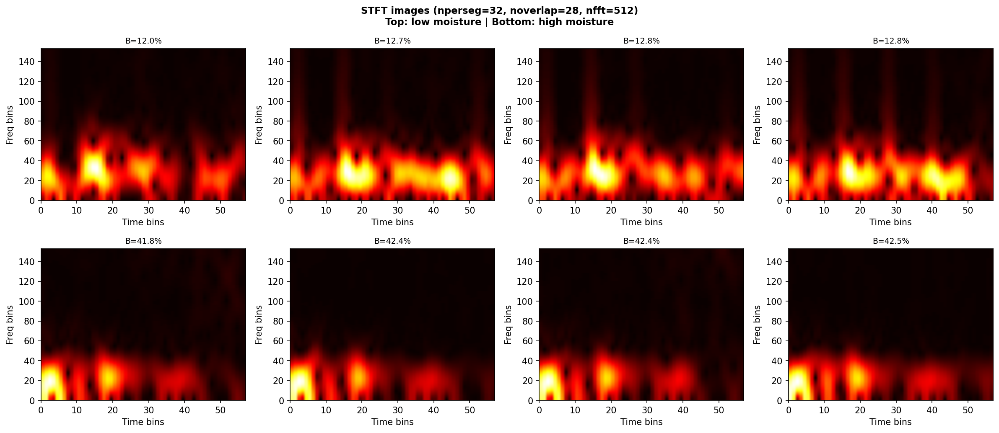
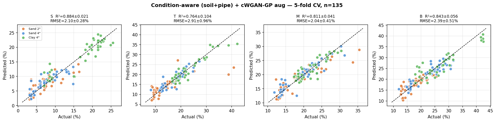

# GPR Moisture Prediction

Using Ground Penetrating Radar (GPR) A-scan signals to predict soil moisture content at multiple depths.

---

## Dataset

| Condition | Soil type | Pipe (dia.) | Pipe top depth | Original | Additional | Total |
|-----------|-----------|-------------|----------------|----------|------------|-------|
| 2 in sand | Sand       | 2"          | 0.40 m         | 39       | 8          | **47** |
| 4 in sand | Sand       | 4"          | 0.35 m         | 40       | 8          | **48** |
| 4 in clay | Sandy clay | 4"          | 0.30 m         | 33       | 7          | **40** |
| **Total** |            |             |                | 112      | 23         | **135** |

A controlled box experiment: the box was filled with soil, watered to different moisture levels, and GPR A-scans were collected at each condition. Soil moisture was measured simultaneously at 4 depths (S / T / M / B). All raw data are in `data/GPR_moisture_merged.xlsx`.

- **A-scan:** 256 time samples, dt = 0.099609 ns (~25 ns window), fs ≈ 10.04 GHz
- **Moisture depths:** S = 0 cm, T = 8 cm, M = 22 cm, B = 35 cm
- **Evaluation:** 5-fold cross-validation (stratified by condition)

---

## Experiment Setup

| Condition | Pipe diameter | Soil type  | Pipe top depth |
|-----------|--------------|------------|----------------|
| 2 in sand | 2"           | Sand       | 0.40 m |
| 4 in sand | 4"           | Sand       | 0.35 m |
| 4 in clay | 4"           | Sandy clay | 0.30 m |

The box was filled with soil and watered to different moisture levels. GPR A-scans were collected at each moisture condition, and soil moisture was measured at 4 depths simultaneously.

### Moisture measurement depths

| Layer       | Depth  |
|-------------|--------|
| S (Surface) | 0 cm   |
| T (Top)     | 8 cm   |
| M (Middle)  | 22 cm  |
| B (Bottom)  | 35 cm  |

---

## Repository Structure

```
GPR_moisture/
├── data/           — raw Excel files + processed numpy arrays
├── scripts/        — all Python scripts
├── results/        — result .npy files + figures
├── references/     — reference papers
└── README.md
```

Run `python scripts/data_prep.py` from the repo root to regenerate numpy files from raw Excel sources.

---

## Method: STFT + 2D CNN

Short-Time Fourier Transform (STFT) converts each 1D A-scan into a 2D time-frequency spectrogram, which is then fed into a 2D CNN. This captures how the frequency content of the GPR signal evolves over time — useful because moisture affects both the amplitude and the frequency-dependent attenuation of the EM wave.

### STFT Parameters

| Parameter      | Value                          | Meaning |
|----------------|-------------------------------|---------|
| `fs`           | 1e9 / 0.099609 ≈ 10.04 GHz   | Sampling frequency |
| `nperseg`      | 32 samples (~3.2 ns)          | Sliding window — smaller = better time resolution |
| `noverlap`     | 28 samples (87.5%)            | High overlap gives smooth time axis |
| `nfft`         | 512                           | Zero-padding for finer frequency grid |
| Frequency range | 0 – 3 GHz                   | Only physically meaningful range kept |
| Output image   | 153 × 57 (freq × time bins)   | Input to 2D CNN |

A shorter window (nperseg=32 vs the 56 used in the reference paper) gives better **time resolution** (~3.2 ns) at the cost of slightly coarser **frequency resolution**, which is better suited to resolving the brief pipe reflection event.

### Model variants explored

Five augmentation and conditioning strategies were tested on top of the baseline STFT + 2D CNN:

1. **Condition-aware head (CA-CNN)** — soil type (Sand / Clay) and pipe diameter (2" / 4") are encoded as separate one-hot vectors and concatenated to the CNN feature vector before the fully connected layers. This lets the model learn the effect of each factor independently.
2. **Gaussian noise augmentation** — for each training fold, 2× noisy copies of the A-scans (σ = 0.02, applied before STFT) are generated and mixed with real data.
3. **Conditional WGAN-GP augmentation** — a conditional Wasserstein GAN (gradient penalty) is trained per fold on 108 real A-scans, conditioned on soil type, pipe diameter, and moisture values. 2× synthetic A-scans are generated via label interpolation between real pairs and mixed with real data for CNN training. Synthetic samples are saved to `data/augmented/gan/`.
4. **Image augmentation (ablation)** — five standard image transforms (horizontal shift, brightness/contrast, Gaussian blur, Gaussian noise, CLAHE) applied directly to STFT spectrograms during training.
5. **Simulation pre-training (Sim2Real)** — the CA-CNN encoder is pre-trained on 375 gprMax FDTD simulations (0.4 / 1.2 / 1.5 GHz, 125 layered conditions each), then fine-tuned on real data with a condition-aware head.

### Results (5-fold stratified CV, n=135)

| Model | S (0 cm) | T (8 cm) | M (22 cm) | B (35 cm) | **Avg R²** |
|-------|----------|----------|-----------|-----------|------------|
| Baseline: STFT + 2D CNN | 0.870 | 0.754 | 0.743 | 0.820 | 0.797 ± 0.056 |
| + Condition-aware head (CA-CNN) | 0.853 | 0.800 | 0.781 | 0.828 | 0.816 ± 0.056 |
| + CA-CNN + Noise aug | 0.839 | 0.744 | 0.785 | 0.834 | 0.801 ± 0.070 |
| **+ CA-CNN + cWGAN-GP aug** | **0.884** | **0.764** | **0.811** | **0.843** | **0.825 ± 0.056** |
| + CA-CNN + Sim pre-train (Sim2Real) | 0.804 | 0.738 | 0.683 | 0.771 | 0.749 ± 0.067 |

The best model (CA-CNN + cWGAN-GP) achieves **Avg R² = 0.825**, a +2.8 pp improvement over the baseline. The condition-aware encoding accounts for most of the gain; GAN augmentation in the raw A-scan domain provides an additional boost. Gaussian noise augmentation did not improve over the condition-aware baseline alone.

### Image augmentation ablation

Standard image-space augmentations were tested individually on STFT spectrograms (CA-CNN, no GAN):

| Augmentation | S | T | M | B | Avg R² | Δ vs no-aug |
|---|---|---|---|---|---|---|
| No augmentation | 0.795 | 0.698 | 0.686 | 0.743 | 0.730 | — |
| Horizontal shift | 0.782 | 0.682 | 0.667 | 0.708 | 0.710 | −0.020 |
| Brightness / contrast | 0.769 | 0.649 | 0.635 | 0.737 | 0.698 | −0.032 |
| Gaussian blur | 0.799 | 0.687 | 0.695 | 0.707 | 0.722 | −0.008 |
| Gaussian noise | 0.787 | 0.692 | 0.667 | 0.698 | 0.711 | −0.019 |
| CLAHE | 0.753 | 0.677 | 0.646 | 0.702 | 0.695 | −0.035 |

All five image-space transforms degraded accuracy. Unlike natural images where semantic content is invariant to photometric changes, STFT spectrograms encode physically meaningful time-frequency energy distributions. Arbitrary image transformations distort the relative amplitude and arrival-time relationships that carry moisture information. This confirms that augmentation should be performed in the raw A-scan domain (as in cWGAN-GP) rather than in the spectrogram image domain.

### Simulation pre-training note

A Sim2Real transfer experiment pre-trained the CA-CNN encoder on 375 gprMax FDTD simulations before fine-tuning on the 135 real samples. The result (Avg R² = 0.749) was below the real-data-only baseline, indicating that the simulation-to-reality domain gap (frequency mismatch: 0.4–1.5 GHz simulated vs 950 MHz measured; perfect layered model vs heterogeneous real soil) outweighs the benefit of additional training samples at the current simulation fidelity. Closing this gap through higher-fidelity simulation (matched antenna model, realistic soil heterogeneity) is a direction for future work.

### STFT Image Examples

Low moisture samples (top row) vs high moisture samples (bottom row), one per layer:



Each image shows:
- **X-axis**: time bins (full ~25 ns A-scan window)
- **Y-axis**: frequency bins (0 – 3 GHz)
- **Color**: signal energy (bright = high energy)

The bright cluster in the lower-left corresponds to the main GPR pulse energy at low frequencies and early arrival time. Changes in moisture shift and attenuate this pattern, which the 2D CNN learns to map to moisture values.

### Predicted vs Actual (best model)

Each point is a held-out prediction from 5-fold CV (every sample tested exactly once).



---

## Reference

Cao, Q., Al-Qadi, I. L., & Abufares, L. (2022). Pavement Moisture Content Prediction: A Deep Residual Neural Network Approach for Analyzing Ground Penetrating Radar. *IEEE Transactions on Geoscience and Remote Sensing*, 60, 1–11.
